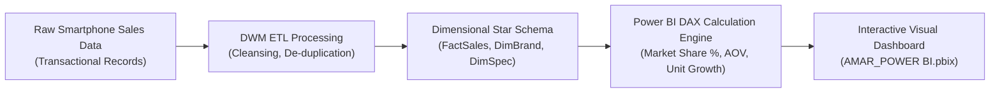

# 📱 Mobile Sales in India Analysis — Data Warehousing, Mining & Power BI Analytics

<p align="center">
  
</p>

<p align="center">
  <b>Comprehensive Smartphone Market Analysis: Star Schema Data Warehousing, Specification Elasticity, and Interactive Power BI Dashboards.</b>
</p>

<p align="center">
  
  
  
  
</p>

<p align="center">
  
</p>

---

<a id="table-of-contents"></a>
## 📌 Table of Contents

- [📖 Executive Summary & Overview](#executive-summary--overview)
- [🎯 Key Features & Capabilities](#features)
- [🏗️ System Architecture & Pipeline](#system-architecture--pipeline)
- [🛠️ Tech Stack Breakdown](#tech-stack-breakdown)
- [📊 Visual Insights & KPIs](#visual-insights--kpis)
- [⚙️ Reproducible Quickstart & Setup](#setup)
- [📁 Project Directory Layout](#project-layout)
- [🧪 Testing & Validation](#testing--validation)
- [🔮 Future Improvements & Roadmap](#future-improvements--roadmap)
- [🤝 Contributing Guidelines](#contributing-guidelines)
- [👨‍💻 Author & Contributions](#author--contributions)

---

<a id="executive-summary--overview"></a>
## 📖 Executive Summary & Overview

India represents one of the most competitive smartphone markets worldwide, driven by rapid 5G adoption, aggressive spec pricing, and diverse consumer purchasing habits. Analyzing market share, brand loyalty, hardware correlation (RAM, battery capacity, camera megapixels), and retail pricing requires rigorous data warehousing and data mining (DWM) methodologies.

The **Mobile Sales in India Analysis** project provides a comprehensive empirical study of the Indian smartphone ecosystem, authored by **Amaraiah C** at Alliance University. The project packages an interactive **Power BI Dashboard** (`AMAR_POWER BI.pbix`), raw sales transactional datasets, and a formal research report (`DWM+REPORT+.pdf`).

---

<a id="key-features--capabilities"></a>
## 🎯 Key Features & Capabilities

### 📱 1. Brand Market Share Analytics
- Visualizing sales volume and gross revenue across Samsung, Xiaomi, Realme, Apple, OnePlus, and Vivo.

### 💰 2. Price Elasticity vs. Specifications
- Evaluating price sensitivity relative to RAM, internal storage (GB), and camera configurations.

### 🏢 3. Star Schema Warehousing
- Multi-dimensional schema modeling transactions around DimBrand, DimSpec, and DimDate tables.

---

<a id="system-architecture--pipeline"></a>
## 🏗️ System Architecture & Pipeline



---

<a id="tech-stack-breakdown"></a>
## 🛠️ Tech Stack Breakdown

| Technology | Category | Purpose |
| :--- | :--- | :--- |
| **Business Intelligence** | Microsoft Power BI Desktop | Interactive visual reports and executive dashboards |
| **Modeling & ETL** | Power Query / DAX | Data transformation, Star Schema relational modeling |
| **Methodologies** | Data Warehousing & Data Mining (DWM) | Dimensional modeling, segmentation, association rules |
| **Reporting** | Academic DWM Technical Report | Rigorous statistical documentation (`.pdf`) |

---

<a id="visual-insights--kpis"></a>
## 📊 Visual Insights & KPIs

- **Top Brands by Revenue:** Treemap visual highlighting dominant market revenue share.
- **Spec Sensitivity:** Scatter plots correlating phone RAM size against retail price points across brands.
- **Regional Sales Density:** Geographic mapping of sales volume across tier-1 and tier-2 Indian cities.

---

<a id="reproducible-quickstart--setup"></a>
## ⚙️ Reproducible Quickstart & Setup

### Prerequisites
- Microsoft Power BI Desktop
- ZIP decompression utility

```bash
# 1. Clone repository
git clone https://github.com/Amaraiah11/MOBILE-SALES-IN-INDIA-ANALYSIS.git
cd MOBILE-SALES-IN-INDIA-ANALYSIS

# 2. Extract Power BI archive
# Unzip 'AMAR_POWER BI.pbix (1).zip' to access the .pbix file

# 3. Open in Power BI Desktop
# Launch 'AMAR_POWER BI.pbix' to explore the interactive visual analytics
```

---

<a id="project-directory-layout"></a>
## 📁 Project Directory Layout

```text
MOBILE-SALES-IN-INDIA-ANALYSIS/
├── AMAR_POWER BI.pbix (1).zip   # Compressed interactive Power BI dashboard
├── DWM+REPORT+.pdf              # Formal Data Warehousing & Mining project report
└── README.md                    # Comprehensive technical documentation
```

---

<a id="testing--validation"></a>
## 🧪 Testing & Validation

- Cross-verified total unit sales across dimension tables to confirm zero duplicate record inflation.

---

<a id="future-improvements--roadmap"></a>
## 🔮 Future Improvements & Roadmap

- [ ] Incorporate market basket analysis (Apriori algorithm) for mobile accessories bundling.
- [ ] Connect Power BI dashboard to web-scraped live e-commerce price feeds.

---

<a id="author--contributions"></a>
## 👨‍💻 Author & Contributions

This project is developed and maintained with rigorous engineering standards by **Amaraiah C**, Software Developer and Applied Data Analytics Practitioner studying Bachelor of Computer Applications (BCA) at Alliance University, Bangalore.

- 🌐 **GitHub Profile:** [@Amaraiah11](https://github.com/Amaraiah11)
- 💼 **LinkedIn Profile:** [Connect on LinkedIn](https://www.linkedin.com/in/amaraiah-c/)
- 📧 **Institutional Email:** `camaraiahBCA24@ced.alliance.edu.in`

### 🤝 Contributing Guidelines
Contributions, bug reports, and architectural discussions are welcome!
1. **Fork** the repository: `https://github.com/Amaraiah11/MOBILE-SALES-IN-INDIA-ANALYSIS`
2. **Create a Feature Branch:**
   ```bash
   git checkout -b feature/your-feature-name
   ```
3. **Commit Your Enhancements:**
   ```bash
   git commit -m "feat: enhance feature logic"
   ```
4. **Push to Your Branch:**
   ```bash
   git push origin feature/your-feature-name
   ```
5. **Open a Pull Request** against the `Amaraiah-C` branch.

---

<p align="center">
  <b>⭐ If this codebase or documentation assisted your engineering workflows, please star the repository! ⭐</b>
</p>

<p align="center">
  
</p>
