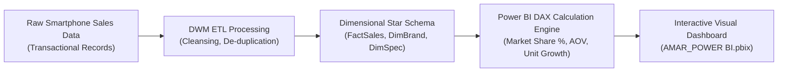

<p align="center">
  
</p>

<p align="center">
  
  
  
  
</p>

<a id="overview"></a>
## 📖 Executive Summary & Overview

India represents one of the largest and most competitive smartphone markets globally, characterized by aggressive price-performance competition, rapid 5G adoption, and diverse consumer purchasing habits. Analyzing market share, brand loyalty, feature correlation (RAM, battery capacity, camera megapixels), and regional retail pricing demands systematic data warehousing and data mining (DWM) methodologies.

The **Mobile Sales in India Analysis** project provides a comprehensive empirical study of the Indian mobile handset ecosystem. Completed as a Data Warehousing & Mining course capstone at Alliance University, this project includes an interactive **Power BI Dashboard** (`AMAR_POWER BI.pbix`), raw sales transactional datasets, and a formal research report (`DWM+REPORT+.pdf`).

<a id="toc"></a>
## 📑 Table of Contents

- [📖 Executive Summary & Overview](#overview)
- [🎯 Key Features & Capabilities](#features)
- [🏗️ System Architecture & Pipeline](#architecture)
- [🛠️ Tech Stack Breakdown](#tech-stack)
- [⚙️ Reproducible Quickstart & Setup](#setup)
- [📁 Project Directory Layout](#project-layout)
- [👨‍💻 Author & Contributions](#author)

<a id="features"></a>
## 🎯 Key Features & Capabilities

- **Brand Market Share Analytics:** Visualizing sales volume and gross revenue across Samsung, Xiaomi, Realme, Apple, OnePlus, and Vivo.
- **Specification vs. Price Elasticity:** Analyzing price sensitivity relative to internal storage (GB), RAM, and camera capabilities.
- **Multidimensional Data Warehousing:** Star schema design organizing facts (sales volume, revenue, units sold) around dimensions (Brand, Model, Date, Location).
- **Interactive Power BI Reporting:** Drill-down slicers enabling temporal and brand-level filtering with calculated DAX metrics.

<a id="architecture"></a>
## 🏗️ System Architecture & Pipeline



<a id="tech-stack"></a>
## 🛠️ Tech Stack Breakdown

| Technology | Category | Purpose |
| :--- | :--- | :--- |
| **Business Intelligence** | Microsoft Power BI Desktop | Interactive visual reports and executive dashboards |
| **Modeling & ETL** | Power Query / DAX | Data transformation, Star Schema relational modeling |
| **Methodologies** | Data Warehousing & Data Mining (DWM) | Dimensional modeling, segmentation, association rules |
| **Reporting** | Academic DWM Technical Report | Rigorous statistical documentation (`.pdf`) |

<a id="setup"></a>
## ⚙️ Reproducible Quickstart & Setup

### Prerequisites
- Microsoft Power BI Desktop
- ZIP decompression utility

```bash
# 1. Clone repository
git clone https://github.com/Amaraiah11/MOBILE-SALES-IN-INDIA-ANALYSIS.git
cd MOBILE-SALES-IN-INDIA-ANALYSIS

# 2. Extract Power BI archive
# Unzip 'AMAR_POWER BI.pbix (1).zip' to access the .pbix file

# 3. Open in Power BI Desktop
# Launch 'AMAR_POWER BI.pbix' to explore the interactive visual analytics
```

<a id="project-layout"></a>
## 📁 Project Directory Layout

```text
MOBILE-SALES-IN-INDIA-ANALYSIS/
├── AMAR_POWER BI.pbix (1).zip   # Compressed interactive Power BI dashboard
├── DWM+REPORT+.pdf              # Formal Data Warehousing & Mining project report
└── README.md                    # Comprehensive technical documentation
```

<a id="author"></a>
## 👨‍💻 Author & Contributions

This project is developed and maintained with high technical rigour by **Amaraiah C**, Software Engineer and Data Analytics Practitioner studying Bachelor of Computer Applications (BCA) at Alliance University.

- 🌐 **GitHub:** [@Amaraiah11](https://github.com/Amaraiah11)
- 💼 **LinkedIn:** [Connect on LinkedIn](https://www.linkedin.com/in/amaraiah-c/)
- 📧 **Institutional Contact:** `camaraiahBCA24@ced.alliance.edu.in`

### 🤝 Contribution Guidelines
Contributions, bug reports, and architectural discussions are welcome!
1. **Fork** the repository: `https://github.com/Amaraiah11/MOBILE-SALES-IN-INDIA-ANALYSIS`
2. **Branch**: `git checkout -b feature/your-feature-name`
3. **Commit**: `git commit -m "feat: enhance feature logic"`
4. **Push**: `git push origin feature/your-feature-name`
5. **Open Pull Request** against the `Amaraiah-C` branch.

---

<p align="center">
  <b>⭐ If this codebase or documentation assisted your engineering workflows, please star the repository! ⭐</b>
</p>

<p align="center">
  
</p>
